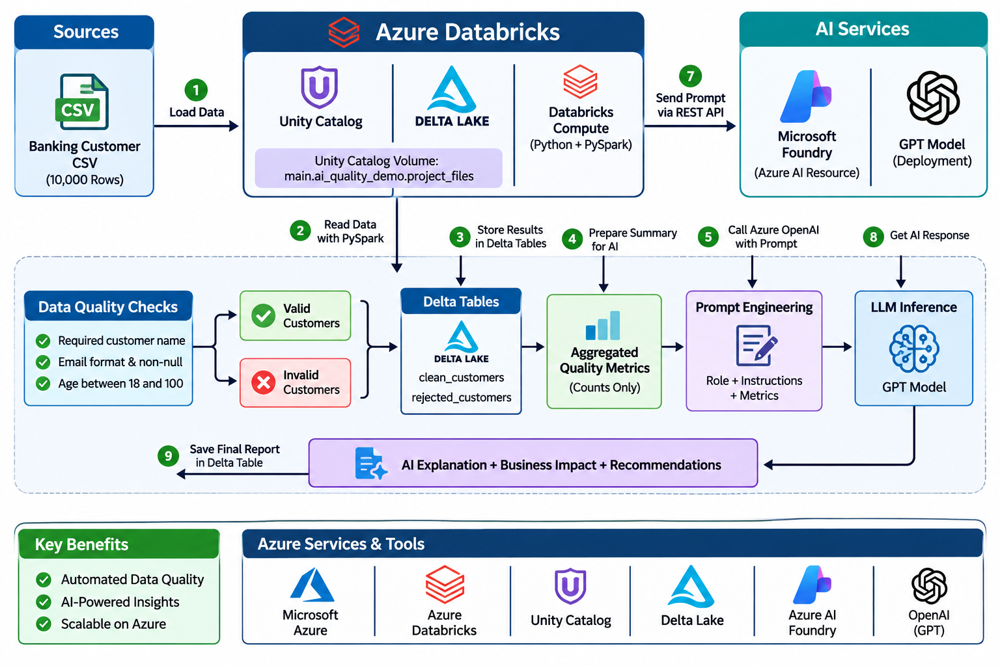

# AI-Powered Data Quality Checker

A beginner-friendly data engineering project that uses Azure Databricks, PySpark, and a deployed model in Microsoft Foundry(Phi-4-mini-instruct) to validate a synthetic 10,000-row customer dataset and produce an AI-written summary of aggregate quality results.

The validation rules are deterministic. The model explains the resulting counts and suggests remediation steps; it does not decide whether individual rows pass, alter records, or delete data.

## Architecture



Only aggregate metrics are sent to the model. The customer rows remain in Databricks.

## Data and validation rules

The demonstration dataset has 10,000 synthetic records and fields such as customer ID, name, email, age, city, state, account type, balance, onboarding date, and active status.

The notebook currently applies these core checks:

- Name is present and not blank.
- Email is present and matches the configured email pattern.
- Age is between 18 and 100, inclusive.

Rows passing all three checks are written to `main.ai_quality_demo.clean_customers`. Rows that fail at least one check are written to `main.ai_quality_demo.rejected_customers` with a `quality_issues` description.

The architecture plan lists duplicate customer IDs, non-positive balances, and missing cities as seeded extension cases. Those checks are **not implemented in the current notebook**.

## Repository contents

- `project_notebook.ipynb` — Databricks notebook for loading data, validating records, calculating metrics, calling the deployed model, and saving results.
- `reports/ai_quality_report.md` — Optional aggregate report generated from the `ai_quality_report` table. Add this file if you want a readable project result in GitHub.
- `docs/architecture.md` — Optional detailed architecture notes.

Delta table contents and customer-level data are stored in Databricks, not in this repository.

## Requirements

- An Azure Databricks workspace with Unity Catalog and a Python-capable compute environment.
- A Unity Catalog volume at `main.ai_quality_demo.project_files`.
- A Microsoft Foundry / Azure AI resource with a deployed chat model and an endpoint compatible with the OpenAI Python SDK.
- The `openai` Python package. The notebook installs it with `%pip install openai` if it is not already available.
- Databricks permissions to read the source file, create or replace the output tables, and access the configured secret scope.

## Setup

1. Place the synthetic input CSV in the Unity Catalog volume. The notebook currently reads:

   ```text
   /Volumes/main/ai_quality_demo/project_files/ai_data_quality_customers_10000.csv
   ```

   If your uploaded file has a different name or path, update `source_path` in the notebook.

2. Store the model endpoint and API key in a Databricks secret scope. The notebook expects:

   - Scope: `ai-quality-scope`
   - Key: `azure-openai-endpoint`
   - Key: `azure-openai-api-key`

   Configure these secrets in your workspace using your organization's approved process. Never put the endpoint or API key directly in the notebook .

3. Confirm `deployment_name` in the notebook exactly matches the model deployment name in your Foundry resource.

4. Open `project_notebook.ipynb` in Databricks and run the cells in order.

## Outputs

The notebook writes these Delta tables:

| Table | Contents |
| --- | --- |
| `main.ai_quality_demo.clean_customers` | Rows passing all implemented checks |
| `main.ai_quality_demo.rejected_customers` | Rows with one or more validation issues |
| `main.ai_quality_demo.ai_quality_report` | AI-generated narrative plus total, valid, and invalid record counts |

The notebook also calculates issue counts for the implemented checks before calling the model. The current report table schema stores the narrative and total/valid/invalid counts; it does not store each individual issue count as a separate column.


## Expected results

For the supplied synthetic dataset and the three core checks, the architecture plan specifies these expected totals:

- Total records: 10,000
- Valid records: 8,950
- Invalid records: 1,050
- Missing names: 300
- Invalid or missing emails: 500
- Invalid ages: 250

These are expected values for the described sample dataset. Recalculate them if the input data or validation rules change.

## Security and data handling

- Use only synthetic or otherwise approved data in this demonstration.
- Keep API credentials in Databricks secrets; never commit credentials, secret values, or private endpoint details.
- Send aggregate metrics to the model, not individual customer rows.
- Review generated AI recommendations before using them. They are explanatory suggestions, not an approval to change or delete records.


## Current limitations

- The notebook validates only required name, email format/non-null, and age range.
- Duplicate IDs, balance rules, and city completeness are planned extensions, not current checks.
- The model report is generated text and may vary between runs. The deterministic counts from PySpark are the source of truth.
- The notebook depends on Databricks paths, Unity Catalog objects, secret configuration, and a deployed model being available in the target environment.
