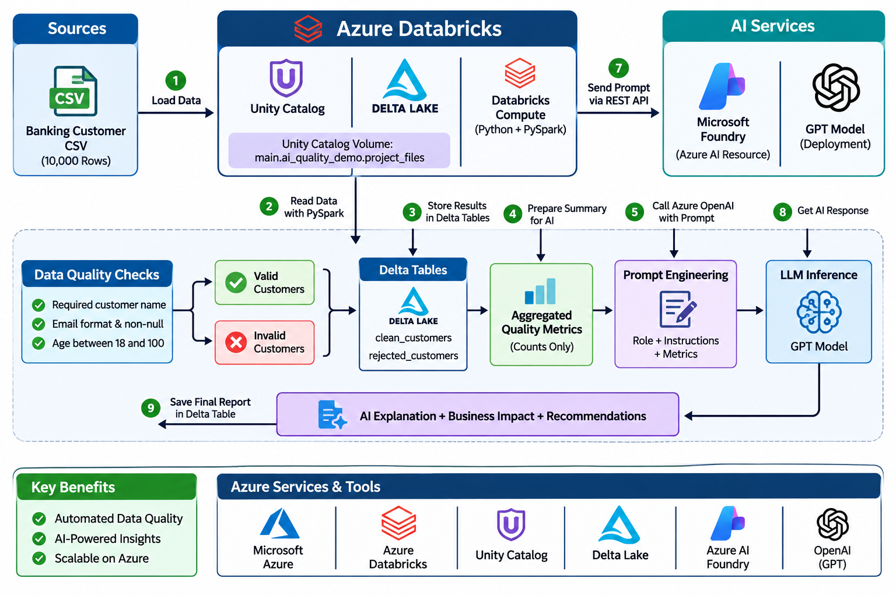

# Project Architecture

## Workflow

1. Load the 10,000-row synthetic customer CSV from a Unity Catalog volume.
2. Use PySpark in Azure Databricks to check required names, email format and presence, and age range.
3. Save passing and rejected records to the `clean_customers` and `rejected_customers` Delta tables.
4. Calculate aggregate quality metrics.
5. Send only those metrics to the deployed model through the Azure AI endpoint.
6. Save the AI explanation and recommendations in the `ai_quality_report` Delta table.

The model explains aggregate results. It does not validate, change, approve, or delete individual customer records.

## Services

- Azure Databricks and PySpark
- Unity Catalog and Delta Lake
- Microsoft Foundry / Azure AI
- OpenAI Python SDK